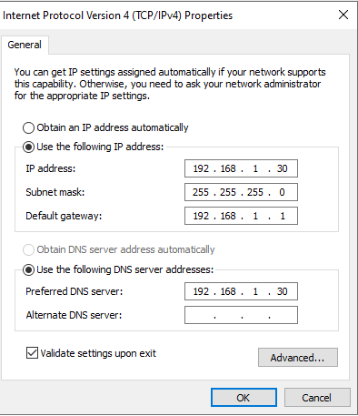
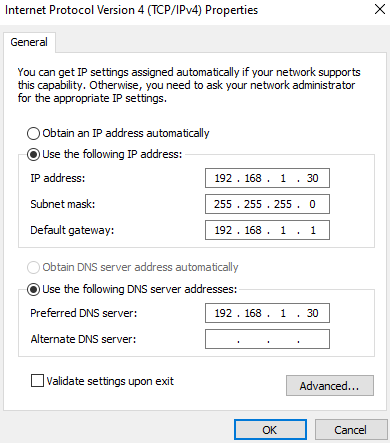
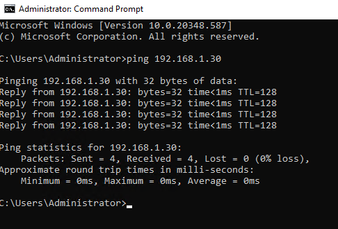
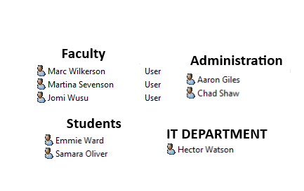
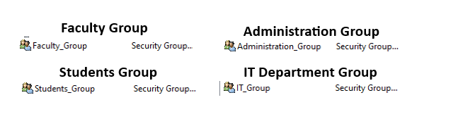

# Summary
Virtualized Windows server and network environment built in Hyper-V. This project includes a Active Directory domain with organizational units, security groups and group policy management. 
Also includes simulated IT help desk ticketing using ServiceNow.

---
# Tools
- Windows Server 2022
- Active Directory
- ServiceNow
- Windows 10/11
- DNS
- DHCP
- Hyper-V
- Group Policy

---
## Server01 IP Configuration

---
## Client01 IP Configuration

---
## Client Ping Test
Confirming connectivity between the client and server after configuration

---
## Active Directory Users And Groups
Four organizational units create to simulate a university. User accounts were created within each organizational unit.

