# Summary
Virtualized Windows server and network environment built in Hyper-V. This project includes an Active Directory domain with organizational units, security groups and group policy management. Simulated IT help desk queue in ServiceNow to document and resolve tickets.

## Contents
- [Tools](#tools)
- [Server01 IP Configuration](#server01-ip-configuration)
- [Client01 IP Configuration](#client01-ip-configuration)
- [Client Ping Test](#client-ping-test)
- [DHCP Configuration](#dhcp-configuration)
- [Active Directory Users And Groups](#active-directory-users-and-groups)
- [Access Control Testing](#access-control-testing)
- [Group Policy Configuration](#group-policy-configuration)
- [**Ticket Simulation (ServiceNow)**](#ticket-simulation)
  - [Users and Departments](#users-and-departments)
  - [Example Ticket Cases](#example-ticket-cases)

---
# Tools
- Windows Server 2022
- Active Directory
- Windows 10/11
- DNS
- DHCP
- Hyper-V
- Group Policy
- ServiceNow

| Component | Details |
|---|---|
| Hypervisor | Hyper-V |
| Domain | jwlab.local (NetBIOS name: JWLAB) |
| Server roles | Active Directory Domain Services, DNS, DHCP, file shares |
| Structure | 4 OUs, one security group per OU, department shared folders |
| Help desk | ServiceNow  |

---
## Server01 IP Configuration

---
## Client01 IP Configuration

---
## Client Ping Test
This confirms the connectivity between the client and server after configuration.

---
## DHCP Configuration
A scope was configured on the server to automatically assign IP addresses

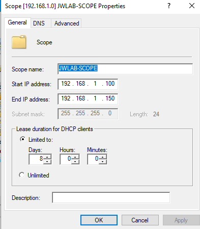
---
## Active Directory Users and Groups
Four organizational units were created to simulate a university. User accounts were created within each organizational unit.
A security group was created for each OU, and users were added to their group to manage shared folder permissions at the group level.

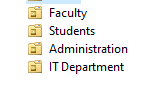

## Access Control Testing
Permissions were verified by accessing a folder while logged in as a faculty user.

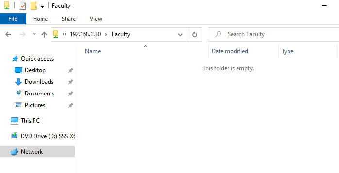

The same user was denied access to an unauthorized department folder

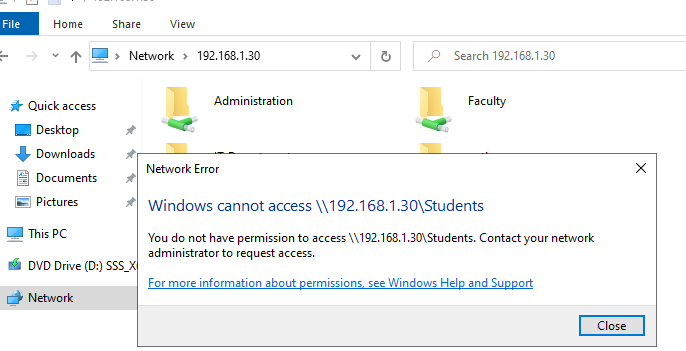

Students folder permissions which only Students_Group and Administrators have access.

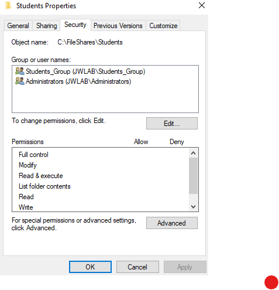
---
## Group Policy Configuration
The password policy requires a minimum password length of 8 characters and enforces password complexity.

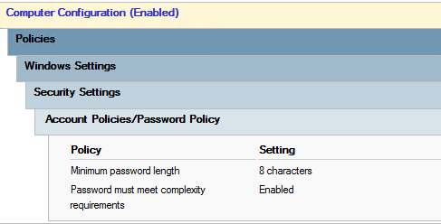

Restrictions and desktop policy: prohibits access to control panel and pc settings and enforces a desktop wallpaper.

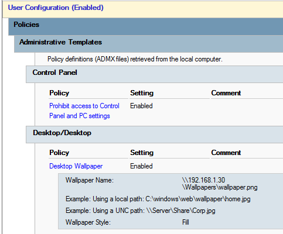

## Ticket Simulation

ServiceNow was used to simulate a help desk queue for the lab environment. Users and departments were created to mirror the lab. Issues were reproduced, troubleshot, and documented with their resolutions.

### Users and Departments
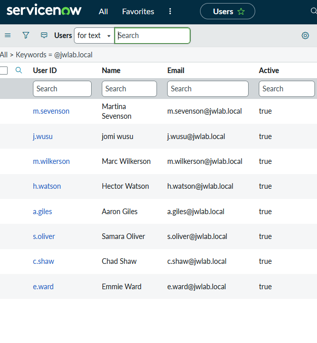
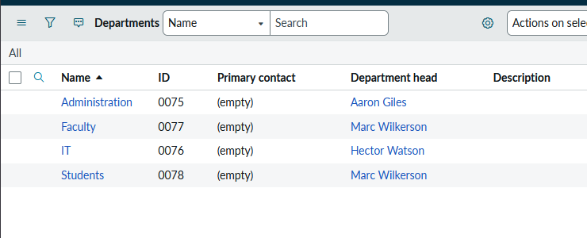

### Example Ticket Cases

#### INC0010009: New User Onboarding
**Request:** New employee Sarah Collins is starting in the Administration department and needs a domain account and access to her department's resources.

**Troubleshooting:**
1. Created the user account in Active Directory under the Administration OU, then added her to the Administration group to receive access to the department’s shared folder

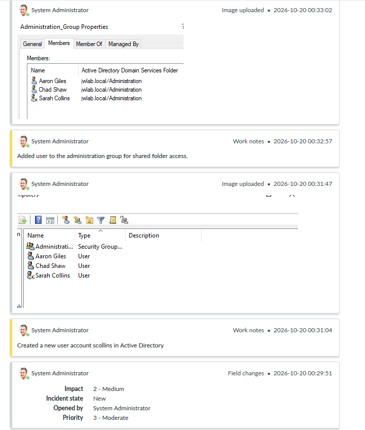

2. Set a temporary password and required a password change at next login. Sarah was able to set a new password that met the domain password policy

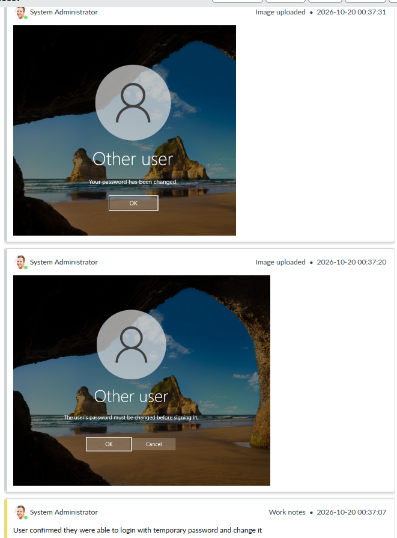

3. Sarah signed in as scollins and opened the Administration folder to confirm she could reach her department’s shared folder.

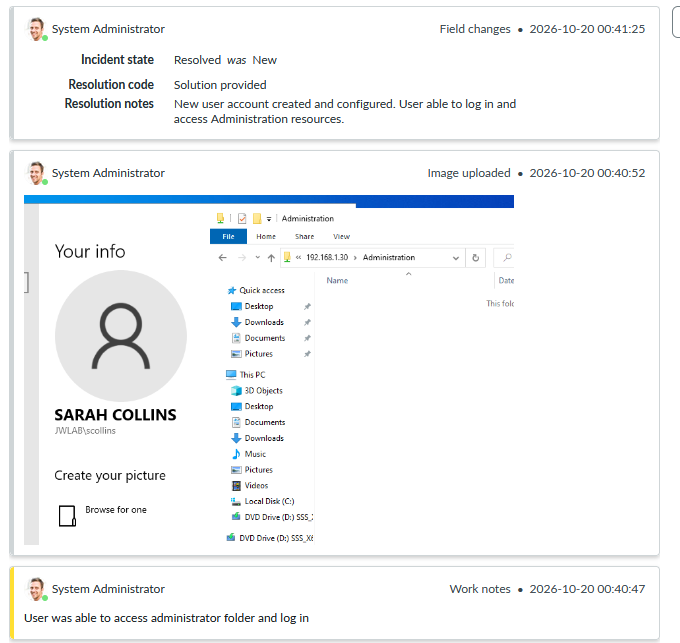

**Resolution:** Account created and configured. The user logged in and accessed Administration resources.

#### INC0010002: Desktop Wallpaper Not Applying

**Request:** Emmie Ward reported that the company wallpaper was not showing up and would like the appropriate wallpaper to be applied.

**Troubleshooting:**
1. Reviewed group policy settings and verified the desktop wallpaper policy is enabled and points to a shared network path. Also confirmed the policy is linked to the Students OU.

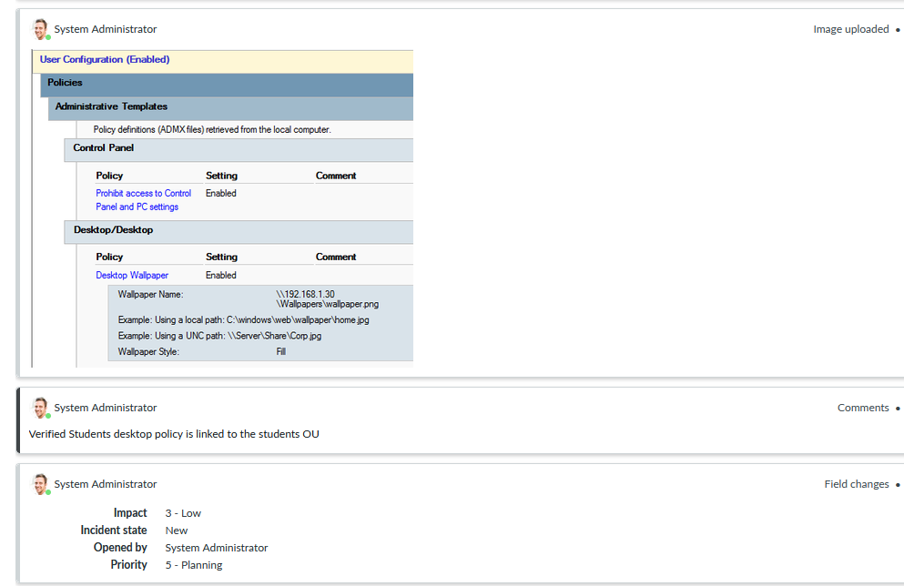

2. Signed in as the user and forced a policy refresh.

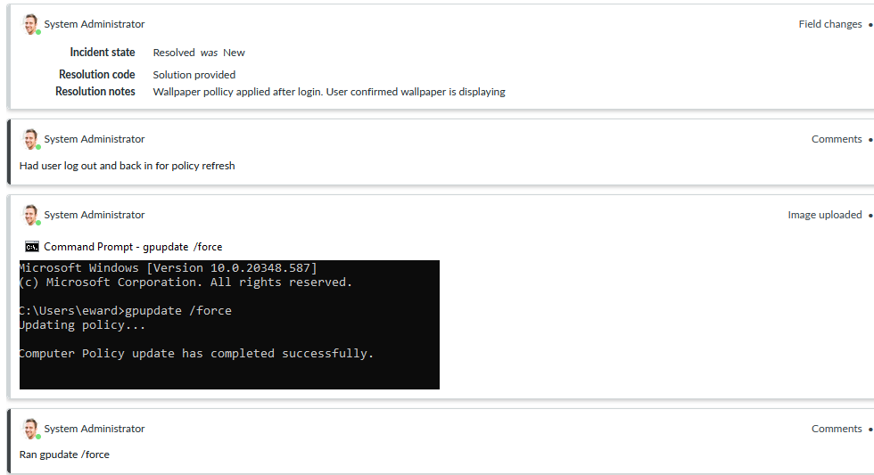

4. Had the user log out and back in so wallpaper can apply and it displayed correctly.

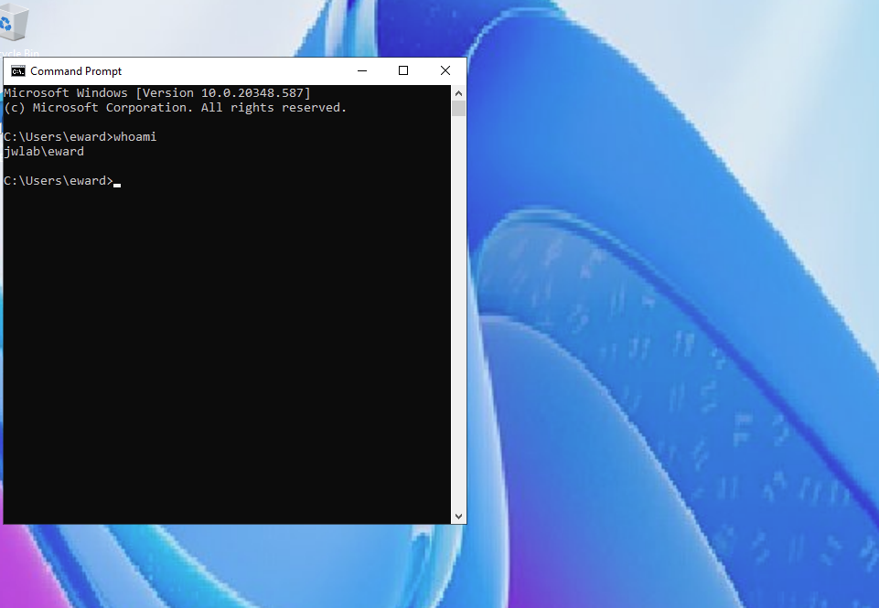

**Resolution:** The policy applied after a policy refresh and logging in again. User confirmed the wallpaper is displayed.

#### INC0010006: Account Locked Out

** Request: Aaron Giles reported he could not log in to his account and would like to unlock his account.**

**Troubleshooting:**
1. Confirmed the issue. The login screen showed account is currently locked.

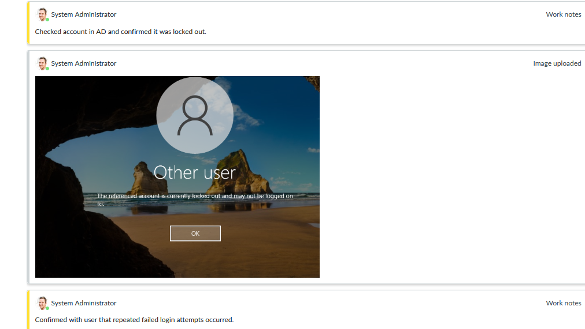

2. Checked the account in Active Directory Users and Computers, confirmed it was locked out, and unlocked it from account tab.

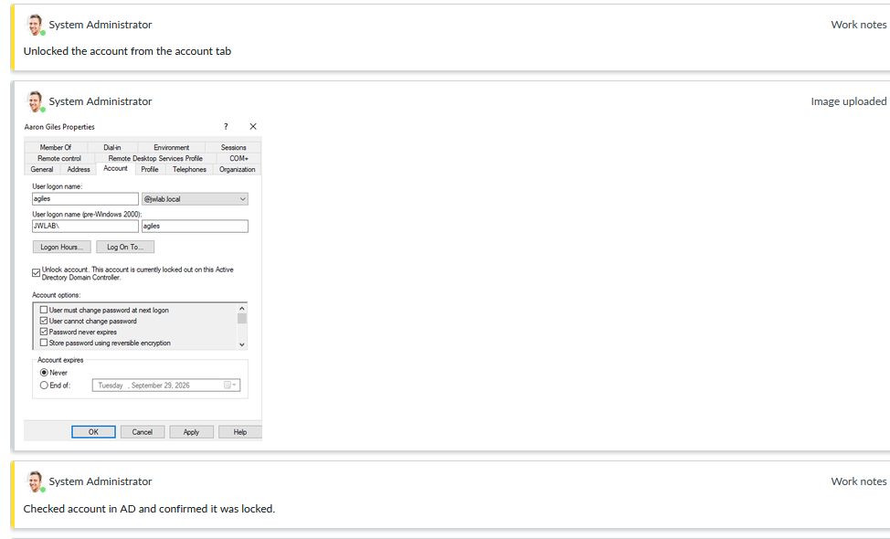

3. Verified the user could sign in with the correct credentials.

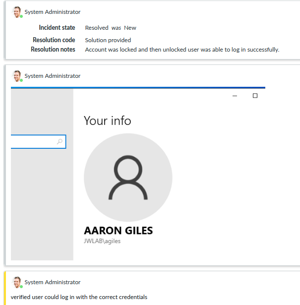

**Resolution:** The account was locked after repeated failed login attempts. I unlocked it in Active Directory and the user logged in successfully.
